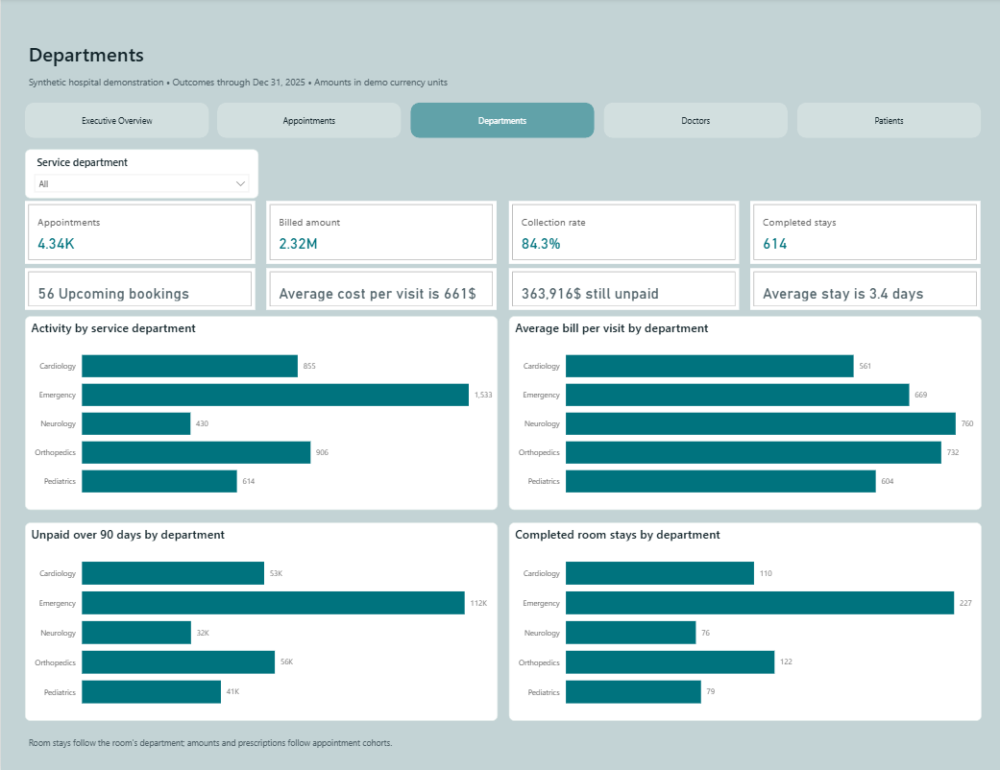
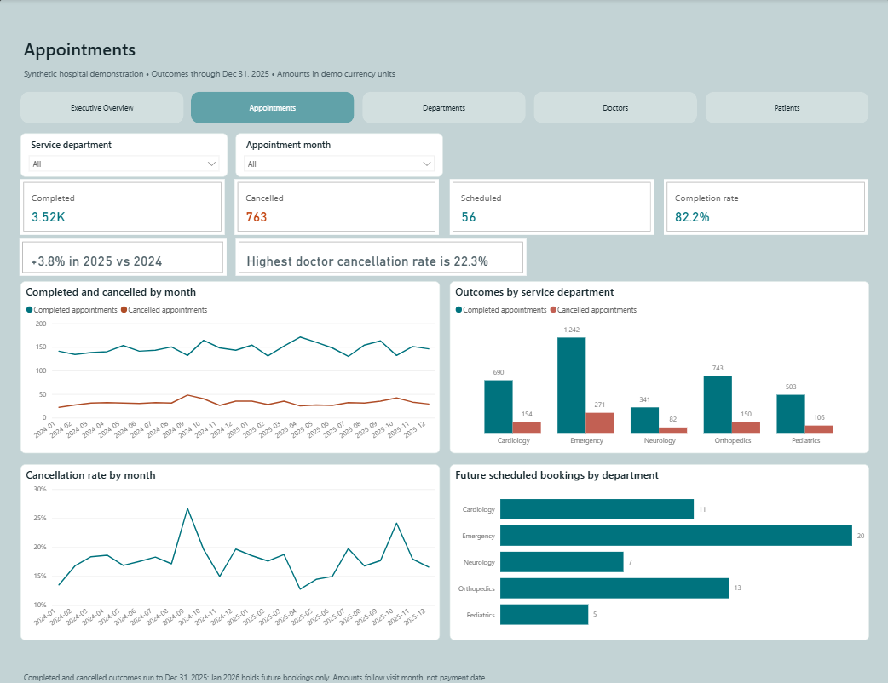
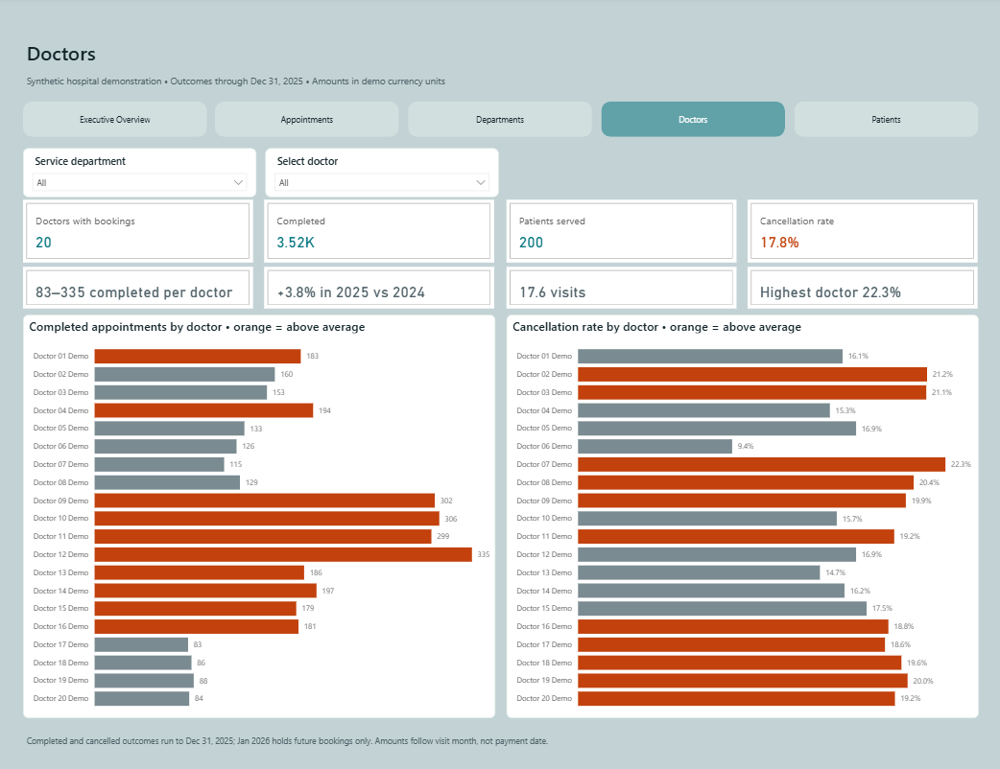
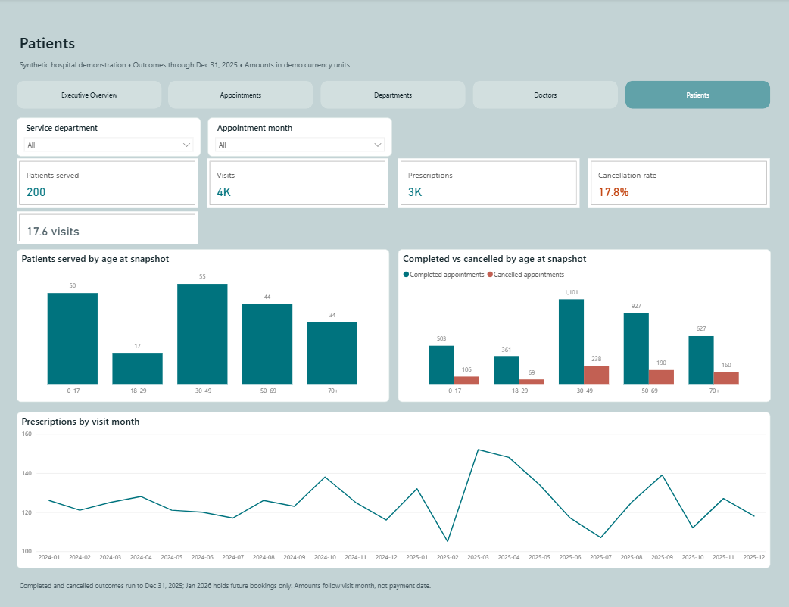
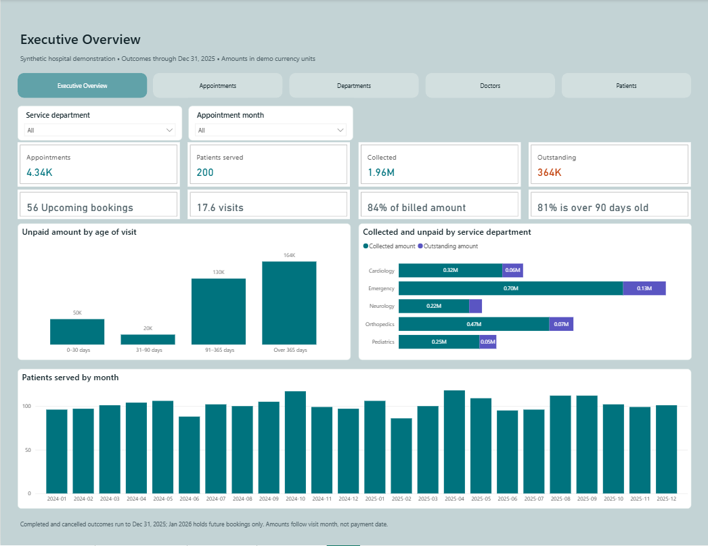

# Hospital Insights Dashboard

## Project Overview

A hospital database management and analytics solution that combines structured data storage with interactive visual dashboards. The project is designed to enable efficient data management and provide actionable insights into hospital operations, patient management, and resource utilization.

## This project includes:

- A SQL database model to manage hospital data.

- Pre-populated database rows for testing and demonstration.

- Power BI dashboards to visualize key performance indicators (KPIs).

## Features

### 1. Database Design:

A relational SQL Server schema for managing hospital operations. The database includes the following key tables:

**Patient:** Stores demographic details of patients.

**Doctor:** Stores the details of doctors, including their specialization and contact details.

**Department:** Defines different hospital departments such as Cardiology, Neurology, etc.

**Appointment:** Manages patient appointments with doctors.

**Medical Records:** Records all patient medical history, including diagnosis and treatment.

**Prescription:** Keeps track of prescribed medicines for each patient's medical record.

**Medicine:** Stores information about available medicines.

**Billing:** Handles billing and payments for hospital services.

**Staff:** Stores information about non-medical staff (nurses, administrative staff, technicians, etc.).

**Room:** Maintains information about hospital rooms and their status.

**Room Assignment:** Records patient room assignments

### 2. Data Visualization:

</br></br></br>

</br></br></br>

</br></br></br>

</br></br></br>

</br></br></br>


## Setup Instructions

### Prerequisites

- **Database Management System**: Microsoft SQL Server 2022+ (SSMS or `sqlcmd`).

- **Power BI Desktop**: For viewing and interacting with dashboards.

### Steps to Recreate the Project

**1. Clone the repository:**

```bash
git clone https://github.com/AhmedOT22/Hospital-Insights-Dashboard.git
```

**2. Set up the database:**

- Open your SQL management tool.

- Select an empty **user database** and execute `sql/model.sql`. The script creates
  the schema in a transaction and refuses to overwrite existing hospital tables.
- Read [schema rules and seed compatibility](sql/README.md) before loading data.
  The original `sql/inserts.sql` is retained for review: its inconsistent billing
  and appointment rows **do not pass the strengthened constraints**. It is not yet
  a clean, supported seed for the revised schema.
- For a verified miniature fixture and constraint checks, run `tests/schema.sql`
  after schema creation in a disposable database. CI runs this on SQL Server 2022.

**3. Open the dashboard:**

- Open `PowerBI/Hospital.pbix` in Power BI Desktop.

- Update the Power BI connection to your database and review the refreshed model.
  The PBIX was not changed or validated against this schema update.

## Contributors:

Ahmed Ouazzani

